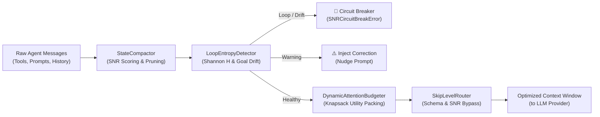

# agent-snr: The Agent Signal Firewall

[](https://github.com/Sandeep-Hipparagi/agent-snr/actions/workflows/ci.yml)
[](https://pypi.org/project/agent-snr/)
[](https://pypi.org/project/agent-snr/)
[](https://opensource.org/licenses/Apache-2.0)
[](https://github.com/astral-sh/ruff)
[](https://mypy-lang.org/)

> **An L4/L5 Signal Firewall for AI Agents**: *Treat agent memory and graph states like a high-efficiency organization.*

`agent-snr` is an ultra-fast, zero-lock-in Python firewall that sits between your agent loops and upstream LLM providers (OpenAI, Anthropic, LiteLLM, LangGraph, CrewAI). It continuously computes the **Signal-to-Noise Ratio (SNR)** of every message, prunes bloated metadata, detects non-convergent retry loops and silent goal drift, and dynamically bypasses unnecessary DAG critique hops.

---

## The Problem: Corporate Bureaucracy in Multi-Agent Graphs

As autonomous agent workflows scale beyond 5–10 steps, they invariably fall victim to three computational bottlenecks:

1. **Context Rot & Token Bloat**: Multi-step tool calls return 15KB–40KB of nested JSON metadata (`request_id`, `trace_id`, `_links`, null headers) and repetitive 40-line `site-packages` Python stack traces. As context accumulates, tokens grow quadratically ($O(N^2)$), degrading LLM reasoning and inflating cost.
2. **Silent Retry Loops & Goal Drift**: When an agent hits an error, it often enters a loop—mutating query keywords slightly or bouncing the unresolved sub-task back and forth between `Planner` and `Executor` while appearing "busy". Alternatively, reasoning subtly drifts away from the user's root goal over successive turns.
3. **Unnecessary Hierarchical Hops**: Static agent graphs enforce rigid review cycles (e.g. `Researcher` $\rightarrow$ `ManagerReviewer` $\rightarrow$ `FinalSynthesizer`) even when early nodes produce unambiguous, schema-validated outputs with high confidence.

`agent-snr` solves this with an in-memory, deterministic **Signal Firewall** adding **$< 1.5\text{ ms}$ overhead** per step.

---

## Architecture



1. **`StateCompactor`**: Computes lexical and semantic novelty scores. Prunes noise keys, collapses whitespace, folds repetitive internal tracebacks, and deduplicates idempotent tool reads.
2. **`LoopEntropyDetector`**: Tracks discrete action entropy ($H_{\text{discrete}}$) and semantic stagnation ($S_t$) across trailing execution frames, combined with EMA Goal Drift ($D_t$) against initial user intents.
3. **`DynamicAttentionBudgeter`**: Knapsack utility density allocation that preserves pinned constraints (system prompt, root goal) and recency windows while respecting strict token ceilings.
4. **`SkipLevelRouter`**: Dynamically evaluates intermediate outputs against Pydantic schemas and SNR thresholds, bypassing redundant evaluation hops.

---

## Empirical Benchmark Results

Measured across **50 trials per scenario** (`seed=42`) comparing unprotected baseline execution against `AgentSNRFirewall`. Reproduced via [`benchmarks/run_all.py`](benchmarks/run_all.py).

### 1. Adversarial Loop & Context Bloat Stress Suite

| Scenario | Baseline Tokens | SNR Tokens | Token Reduction | Baseline Steps | SNR Steps | Loop Intercept Rate | False Positive Break Rate |
|:---|---:|---:|---:|---:|---:|---:|---:|
| **Argument-Mutation Tool Retry Loop** | 24,950 | 242 | **99.0%** | 25.0 | 3.0 | **100.0%** | 0.0% |
| **Ping-Pong Multi-Agent Delegation Loop** | 12,674 | 417 | **96.7%** | 25.0 | 5.0 | **100.0%** | 0.0% |
| **Bloated JSON & Stack-Trace Explosion** | 119,900 | 15,148 | **87.4%** | 10.0 | 10.0 | *N/A (Bloat)* | 0.0% |
| **Silent Semantic Goal Drift** | 4,186 | 166 | **96.0%** | 12.0 | 3.0 | **100.0%** | 0.0% |
| **Control Group (Valid SE Workflow)** | 2,963 | 2,165 | **26.9%** | 11.0 | 11.0 | *N/A (Valid)* | **0.0%** |
| **Overall Stress Benchmark Average** | **8,234,700** | **906,900** | **89.0%** | — | — | **100.0%** | **0.0%** |

### 2. Trajectory Replay A/B Evaluation (20 Representative Workflows)

Replayed across 20 representative real-world workflows (coding, API orchestration, research):

| Metric | Baseline Agent | AgentSNRFirewall | Optimization Impact |
|:---|---:|---:|:---|
| **Total Prompt Tokens Consumed** | 25,305 | 19,376 | **-23.4% prompt tokens** |
| **Mean Peak Context Window** | 317.5 tokens | 216.5 tokens | **-31.8% peak window** |
| **LLM Hops Saved via SkipLevelRouter** | 0 hops (0.0%) | 20 / 20 hops | **100.0% eligible skips saved** |
| **Critical Fact Retention Recall** | 100.0% | 100.0% | **Zero constraint amnesia** |
| **Per-Step Firewall Latency Overhead** | 0.00 ms | **p50: 0.76 ms \| p95: 1.43 ms** | **Sub-10ms latency confirmed** |

To reproduce these numbers locally:
```bash
python benchmarks/run_all.py --trials 50
```

---

## Installation

```bash
# Core package (zero ML model dependencies out of the box)
pip install agent-snr

# Optional fast on-device semantic embeddings (fastembed + BGE)
pip install "agent-snr[embeddings]"

# Optional LangGraph extras
pip install "agent-snr[langgraph]"
```

---

## Quickstart Integrations

### 1. Read-Only Telemetry Audit (`dry_run=True` / CLI)

Profile token waste and loop occurrences in your existing agent without altering outputs:

```bash
# Run the interactive CLI diagnostic demo
agent-snr demo
```

In Python:
```python
from agent_snr import AgentSNRFirewall

# Profile in dry-run mode
firewall = AgentSNRFirewall(dry_run=True)
optimized_msgs, action, metrics = firewall.process_outbound(
    session_id="audit_01",
    node_id="researcher",
    messages=messages,
)

# Print rich diagnostic telemetry summary
firewall.profiler.print_report()
```

### 2. OpenAI & LiteLLM Drop-In Wrapper

Wrap any sync or async OpenAI-compatible client. `agent-snr` automatically intercepts outbound payloads, prunes noise, and enforces circuit breakers:

```python
from openai import OpenAI
from agent_snr import SNRWrappedOpenAI

# Wrap native OpenAI client
client = SNRWrappedOpenAI(OpenAI(), session_id="user_session_42")

response = client.chat.completions.create(
    model="gpt-4o",
    messages=[
        {"role": "user", "content": "Analyze system performance"},
        {"role": "tool_result", "content": bloated_json_string},
    ],
    snr_node_id="analyst",  # optional node tag for trajectory tracking
)

# Access diagnostic profiler metrics
client.profiler.print_report()
```

### 3. LangGraph Node Guard & Skip-Level Router

Protect LangGraph nodes from bloat and bypass intermediate critique nodes when output meets schema:

```python
from pydantic import BaseModel
from langgraph.graph import StateGraph
from agent_snr import LangGraphSNRAdapter, SkipRule

class DiagnosticBrief(BaseModel):
    status: str
    confidence: float

adapter = LangGraphSNRAdapter(session_key="thread_id")

# Register skip-level bypass rule
adapter.firewall.router.register_rule(
    SkipRule(
        source_node="Validator",
        bypassed_node="ManualReviewer",
        target_node="Deployer",
        min_snr=0.40,
        output_schema=DiagnosticBrief,
    )
)

# Decorate execution nodes (supports both sync and async)
@adapter.guard_node("Validator")
def validator_node(state):
    ...
    return state

# Guard conditional edges
builder = StateGraph(...)
builder.add_conditional_edges(
    "Validator",
    adapter.skip_router("Validator", default_router_fn),
)
```

### 4. CrewAI Step Callback

Enforce loop entropy detection and automatic circuit breaking on repetitive tool calls in CrewAI:

```python
from crewai import Agent, Task, Crew
from agent_snr import CrewAISNRHook

hook = CrewAISNRHook(session_id="incident_triage")

crew = Crew(
    agents=[...],
    tasks=[...],
    step_callback=hook.as_callback(),
)
crew.kickoff()
```

---

## Configuration & Tuning Reference

`AgentSNRFirewall` comes pre-configured with balanced defaults, but every threshold can be customized:

| Parameter | Default | Component | Description |
|:---|:---:|:---|:---|
| `snr_drop_threshold` | `0.08` | `StateCompactor` | Frames below this score are suppressed as low-signal duplicates. |
| `max_frame_tokens` | `512` | `StateCompactor` | Maximum token ceiling for individual tool outputs before truncation. |
| `max_json_depth` | `5` | `StateCompactor` | Maximum recursion depth when pruning nested JSON dictionaries. |
| `max_list_items` | `15` | `StateCompactor` | Maximum items retained per list in JSON payloads before folding. |
| `entropy_warn` | `0.30` | `LoopEntropyDetector` | Triggers `INJECT_CORRECTION` to nudge the agent to alter strategy. |
| `entropy_break` | `0.15` | `LoopEntropyDetector` | Triggers `CIRCUIT_BREAK` (`SNRCircuitBreakError`) on action loops. |
| `drift_break` | `0.78` | `LoopEntropyDetector` | Triggers `CIRCUIT_BREAK` when EMA drift from initial goal exceeds threshold. |
| `max_context_tokens` | `8192` | `DynamicAttentionBudgeter` | Hard ceiling for total tokens in allocated context window. |
| `recency_window` | `2` | `DynamicAttentionBudgeter` | Number of trailing non-pinned frames preserved unconditionally. |
| `decay_lambda` | `0.08` | `DynamicAttentionBudgeter` | Exponential decay rate penalizing stale trajectory history. |
| `SkipRule.min_snr` | `0.45` | `SkipLevelRouter` | Minimum SNR score required to trigger a DAG skip-level bypass. |
| `SkipRule.min_goal_similarity`| `0.72` | `SkipLevelRouter` | Minimum cosine similarity with root user goal to permit skip. |

---

## Roadmap

- [x] Canonical data structures (`SignalFrame`, `TraceLedger`) & zero-dependency `HashNgramEmbedder`.
- [x] Deterministic multi-tier `StateCompactor` (JSON pruning, traceback folding, deduplication).
- [x] Discrete Shannon entropy & EMA Goal Drift detector (`LoopEntropyDetector`).
- [x] Dynamic attention knapsack budgeter (`DynamicAttentionBudgeter`).
- [x] Skip-level graph routing (`SkipLevelRouter`).
- [x] Framework adapters: OpenAI, LiteLLM, LangGraph, CrewAI.
- [x] Reproducible adversarial loop benchmarks & trajectory replay evaluation harness.
- [ ] Redis/Postgres-backed distributed ledger persistence.
- [ ] Auto-tuning hyperparameters based on trajectory history.

---

## Contributing & License

Contributions, issues, and feature requests are welcome! See [`CONTRIBUTING.md`](CONTRIBUTING.md) for local development instructions.

`agent-snr` is authored by **Sandeep Hipparagi** and licensed under the [Apache License 2.0](LICENSE).
